# AI Quant Assistant

[](https://github.com/gaoshouxiaoxi/AI-Quant-Assistant/actions/workflows/ci.yml)
[](https://www.python.org/)
[](LICENSE)
[](tests/)

An AI-powered quantitative analysis platform.

**这个项目的重点不是"预测得准"，而是"结论经得起检验"。**
每条结论都配了基线对照、前向验证与置信区间；测不出效果的部分会如实写成负面结论。

## Features

- 股票数据获取（多源自动降级 + 复权体检）
- 技术分析与 K 线可视化
- 双均线策略回测（手续费、滑点、整股成交、基准对比）
- 波动率预测（Yang-Zhang / HAR，样本外 Skill +28.5%）
- Streamlit 网页界面
- 35 个单元测试 + GitHub Actions CI

## 目录

- [复现研究结果](#复现研究结果)
- [快速开始](#快速开始)
- [网页界面](#网页界面第-7-周)
- [示例结果](#示例结果)
- [核心发现：能预测什么、不能预测什么](#核心发现能预测什么不能预测什么)
- [方法审计](#方法审计2026-10四项修复与结论复核)
- [测试](#测试)
- [项目结构](#项目结构)
- [贡献](#贡献)
- [License](#license)

## 复现研究结果

核心结论可以在**干净环境、不联网**的条件下一条命令重算：

```bash
pip install -r requirements-dev.txt
python run_experiment.py --check
```

预期输出：`全部一致（容差 1e-06）—— 复现成功`（约 4 秒）。

主实验只读仓库内**已提交**的 60 分钟 bar（`data/minute/*_60m.csv`，每只 1970 根），
协议全部外置在 `configs/research_main.json`，元数据（git commit、依赖版本、
数据文件 sha256、随机种子）写在 `reports/research/manifest.json`。

完整说明见 **[docs/reproduction.md](docs/reproduction.md)**。

## Tech Stack

- Python（pandas / numpy / scikit-learn / xgboost / matplotlib）
- Streamlit
- pytest + GitHub Actions

## 快速开始

```bash
# 1. 创建并激活虚拟环境
python -m venv venv
venv\Scripts\activate        # Windows

# 2. 安装依赖
pip install -r requirements.txt

# 3. 抓取数据并保存 CSV
python src/fetch_data.py
python src/fetch_data.py TSLA
python src/fetch_data.py 600519 2020-01-01 2025-01-01   # A 股

# 4. 数据分析：K 线图 + 收益率 + 波动率 + 回撤 + 均线策略信号
python src/analyze.py                       # 默认 AAPL 与 600519
python src/analyze.py AAPL                  # 只分析一个
python src/analyze.py AAPL,600519 2022-06-15 2024-12-31

# 5. 启动网页界面（推荐先试这个）
streamlit run app.py
```

> **注意（Windows）**：本机 `python3` 指向微软商店占位程序，请一律使用 `python`。

## 网页界面（第 7 周）

```bash
streamlit run app.py
```

浏览器打开 `http://127.0.0.1:8501`，左侧选标的、日期区间与回测参数，右侧四个标签页：

| 标签页 | 内容 |
| --- | --- |
| **概览** | 区间收益 / 年化收益 / 年化波动 / 夏普 / 最大回撤 + K 线与金叉死叉信号 |
| **均线策略** | 最终资产、策略 vs 买入持有、超额、笔数、胜率、平均持仓天数、净值与回撤曲线 |
| **波动率预测** | 当前 20 日 Yang-Zhang 波动、未来 5 日 HAR 预测（含变化方向）、样本外 R² |
| **说明与局限** | 能预测什么、不能预测什么，方法论要点与免责声明 |

### 界面截图

以贵州茅台（600519）为例，区间 2022-06-15 ~ 2024-12-31：

**概览**：5 个风险收益指标 + K 线与金叉死叉标记

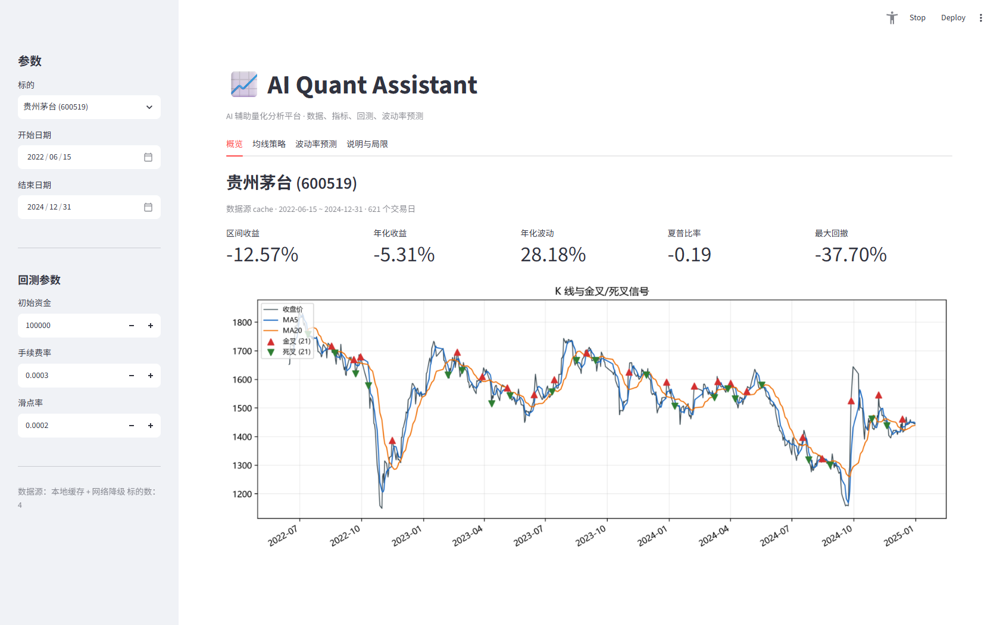

**均线策略**：回测结果一览 + 净值与回撤曲线

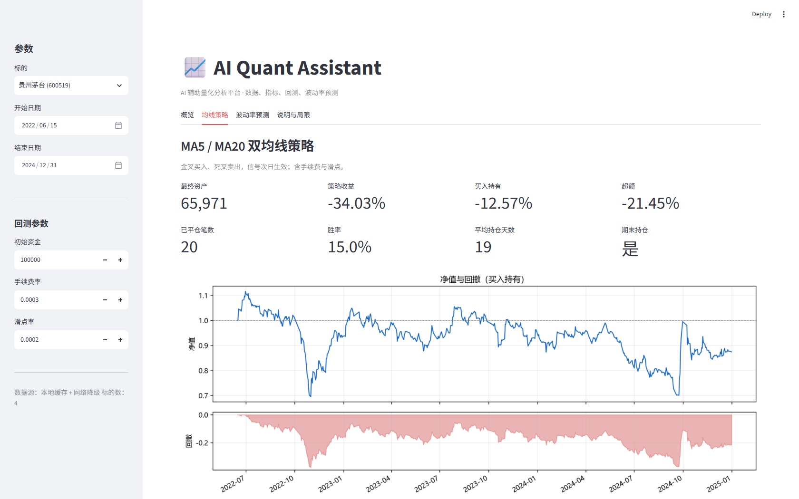

**波动率预测**：当前波动、未来 5 日预测、样本外 R²、历史波动曲线

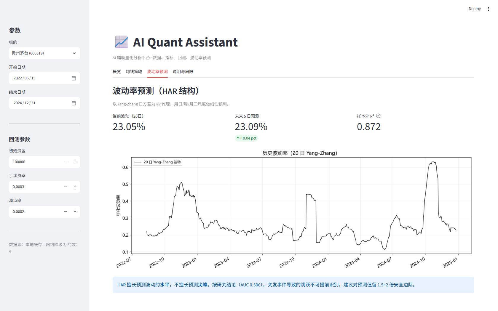

> 截图由 `scripts/take_screenshots.py` 自动生成（Playwright 驱动本机已装的 Edge，
> `channel="msedge"`，无需下载 Chromium）。复现步骤：先起服务，再运行脚本。

几点实现细节：

- 数据优先读本地缓存（`load_daily(..., cache_dir=...)`），避免每次刷新都打网络接口
- Streamlit 的 `@st.cache_data` 缓存行情与预测，切换标签页不会重复计算
- 使用 `width="stretch"` 而非已弃用的 `use_container_width`
- 中文字体沿用 `setup_chinese_font()`，图表不会出现方框

**验证方式**：用 Streamlit 官方测试框架 `AppTest` 无头运行整个界面，
确认 **0 异常**，并核对渲染出的指标数值与命令行结果一致（例如 600519
的区间收益 -12.57%、策略收益 -34.03%、买入持有 -12.57%）。

## 示例结果

`python src/analyze.py`（区间 2022-06-15 ~ 2024-12-31，前复权日线）：

| 标的 | 年化收益 | 年化波动 | 夏普 | 最大回撤 |
| --- | --- | --- | --- | --- |
| Apple (AAPL) | +27.38% | 25.22% | 1.09 | -28.38% |
| 贵州茅台 (600519) | -5.31% | 28.18% | -0.19 | -37.70% |

指标口径：年化按 252 个交易日复利；夏普比率按无风险利率 0 计算。

### MA5 / MA20 均线策略

规则：**MA5 上穿 MA20 买入（金叉），下穿卖出（死叉）**，信号次日生效，
未计手续费与滑点（正式回测见第 4 周）。

| 标的 | 买入持有 | MA5/MA20 策略 | 金叉 | 死叉 |
| --- | --- | --- | --- | --- |
| Apple (AAPL) | 1.8491 (+84.91%) | 1.4351 (+43.51%) | 13 | 13 |
| 贵州茅台 (600519) | 0.8743 (-12.57%) | 0.6706 (-32.94%) | 21 | 21 |

**结论：这段区间里双均线策略明显跑输买入持有。** 均线是滞后指标，上涨途中反复
被"洗"出场（AAPL 的 13 次金叉多数落在震荡区）；茅台 21 次信号意味着约每 30 个
交易日换一次手，摩擦成本极高。这不是 bug，而是均线策略在趋势市 + 震荡市中的
常见表现，也正是第 4 周正式回测要量化的核心问题。

### 回测结果（含手续费与滑点）

`src/backtest.py` 是手写回测引擎，口径：初始资金 100000，手续费 0.03%，
滑点 0.02%（买入抬高、卖出压低），整股成交，**信号次日按收盘价成交**。

| 标的 | 最终资产 | 总收益 | 年化 | 年化波动 | 夏普 | 最大回撤 | 买入持有 | 超额 |
| --- | --- | --- | --- | --- | --- | --- | --- | --- |
| AAPL | 141,712 | +41.71% | 14.71% | 16.99% | 0.87 | -18.32% | +84.91% | **-43.20%** |
| 600519 | 65,971 | -34.03% | -15.53% | 15.03% | -1.03 | -42.12% | -12.57% | **-21.45%** |

| 标的 | 已平仓笔数 | 胜率 | 平均持仓天数 |
| --- | --- | --- | --- |
| AAPL | 12 | 33.33% | 39.8 天 |
| 600519 | 20 | 15.00% | 18.9 天 |

两个标的都跑输买入持有，且**茅台的胜率只有 15%**——20 笔交易里 17 笔亏损。
手续费和滑点在这里不是主因（双边各 0.05%，40 次事件也才约 2%），
主因是**频繁进出造成的趋势断裂**。

### 双引擎交叉验证

`src/backtrader_check.py` 用 Backtrader 独立复算同一策略，两边使用**完全相同的
信号**，只让执行与记账不同：

| 标的 | 手写引擎 | Backtrader | 成交事件数 | 相对偏差 |
| --- | --- | --- | --- | --- |
| AAPL | 141,712.05 | 148,201.39 | 25 vs 25 | 4.58% |
| 600519 | 65,971.41 | 68,288.28 | 41 vs 41 | 3.51% |

**成交事件数完全一致**是最强的正确性证据（AAPL 12 笔往返 = 24 次事件 + 1 次
未平仓 = 25；600519 20 笔往返 + 1 = 41）。剩余 3~5% 的资产差异来自
**Backtrader 的订单生命周期**：`next()` 里下的单，平仓要等下一根 bar 结算，
而手写引擎的语义是"目标日收盘价成交"，因此成交日期会差 1~3 个交易日。

这个脚本的实际价值是**防腐**：一旦 `backtest.py` 的成交逻辑被改坏，
两边偏差会明显超出 6% 容差并被发现。

| K 线图 | 净值与回撤 | 策略信号 | 策略 vs 买入持有 |
| --- | --- | --- | --- |
| 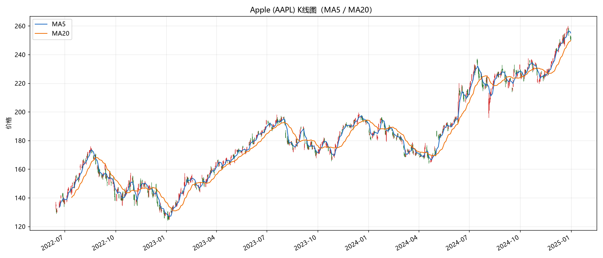 | 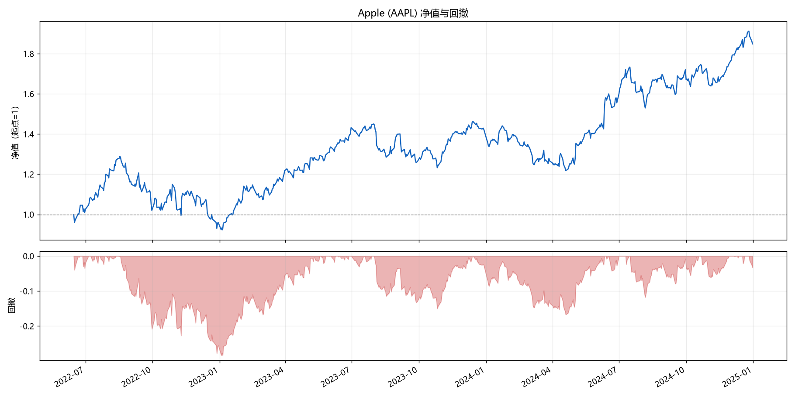 | 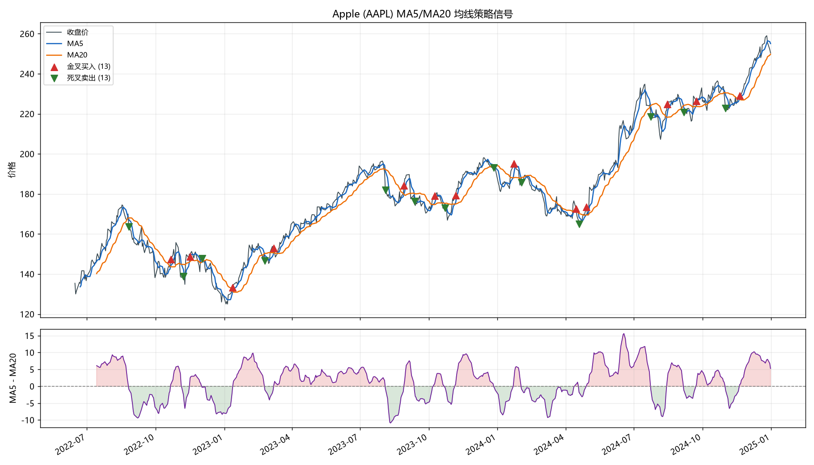 | 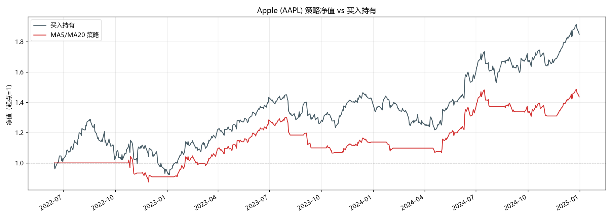 |
| 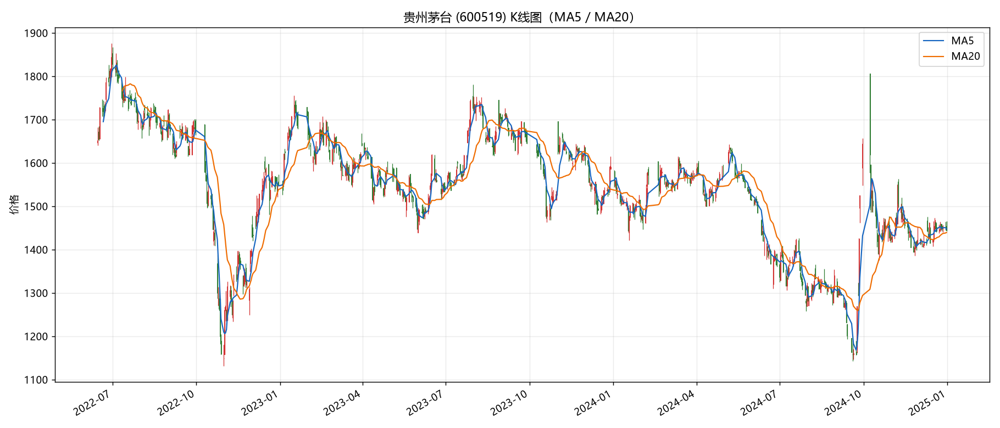 | 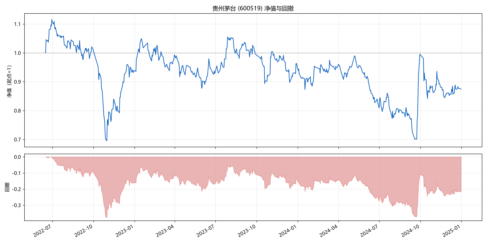 | 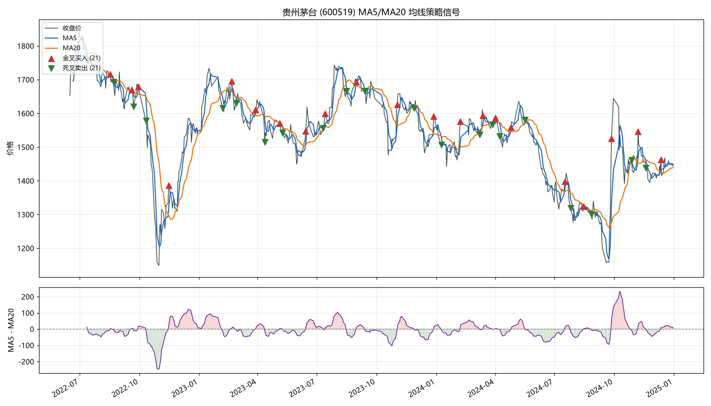 | 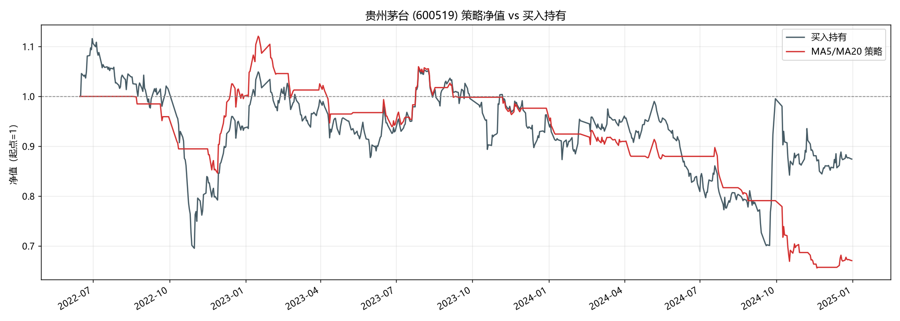 |

## 第 5-6 周：机器学习预测

任务：用**过去 20 个交易日**的 OHLCV + 技术指标，预测**次日收盘价是否上涨**。
共 34 个特征，分三类：滞后收益（20 个）、技术指标（均线偏离/波动率/RSI/量比/动量）、
K 线形态（实体、上下影线、跳空）。

```bash
python src/ml_predict.py AAPL,600519
```

### 方法上刻意避开的三件事

1. **不做随机切分**：金融时序随机打乱会让未来样本进入训练集，指标会虚高到 70%+。
   这里用**扩展窗口前向验证**（5 折，训练集永远是测试集的过去）。
2. **标准化放在每折内部**：先全量标准化再切分会把测试集均值/方差泄漏进训练。
3. **必须对照基线**：上涨天数天然多于下跌，"恒预测多数派"就是免费基线。

### 结果（样本外，2022-06-15 ~ 2024-12-31）

| 标的 | 模型 | 准确率 | AUC | 精确率 | 召回率 | F1 | 超基线 |
| --- | --- | --- | --- | --- | --- | --- | --- |
| AAPL | RandomForest | 50.67% | 0.467 | 55.19% | 63.94% | 0.592 | -5.39% |
| AAPL | XGBoost | 46.63% | 0.466 | 52.58% | 49.04% | 0.507 | -9.43% |
| 600519 | RandomForest | 58.33% | 0.522 | 58.62% | 21.25% | 0.312 | +2.78% |
| 600519 | XGBoost | 51.94% | 0.513 | 45.52% | 41.25% | 0.433 | -3.61% |

**结论：这批特征在这段区间上没有可用的预测能力。**

- AAPL 的 AUC 是 **0.467**，低于 0.5——比随机猜还差。
- 600519 的 RF 准确率 58.33% 看似超过基线 55.56%，但 **AUC 只有 0.522**，
  且召回率仅 21.25%——它几乎只在最有把握时才预测"涨"，靠的是少猜取胜，
  不是真预测能力。这种"高准确率 + 低召回"是最容易被误读的陷阱。
- 特征重要性 Top 全是滞后收益（`f_ret_lag15/17/9/7`），说明模型在拟合噪声。

这个负面结果本身是有价值的：**日频量价特征预测次日方向，接近有效市场假说**。
真正的信号通常来自更低频、更多外部信息（基本面、舆情、资金流）或更长预测周期。

| AAPL 预测概率 | AAPL 特征重要性 |
| --- | --- |
| 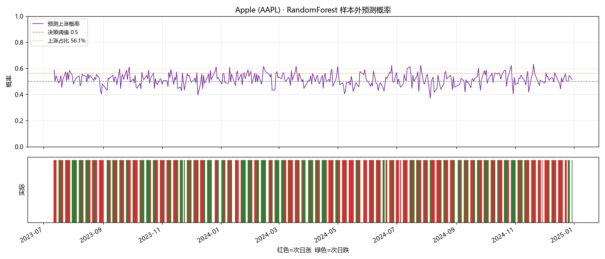 | 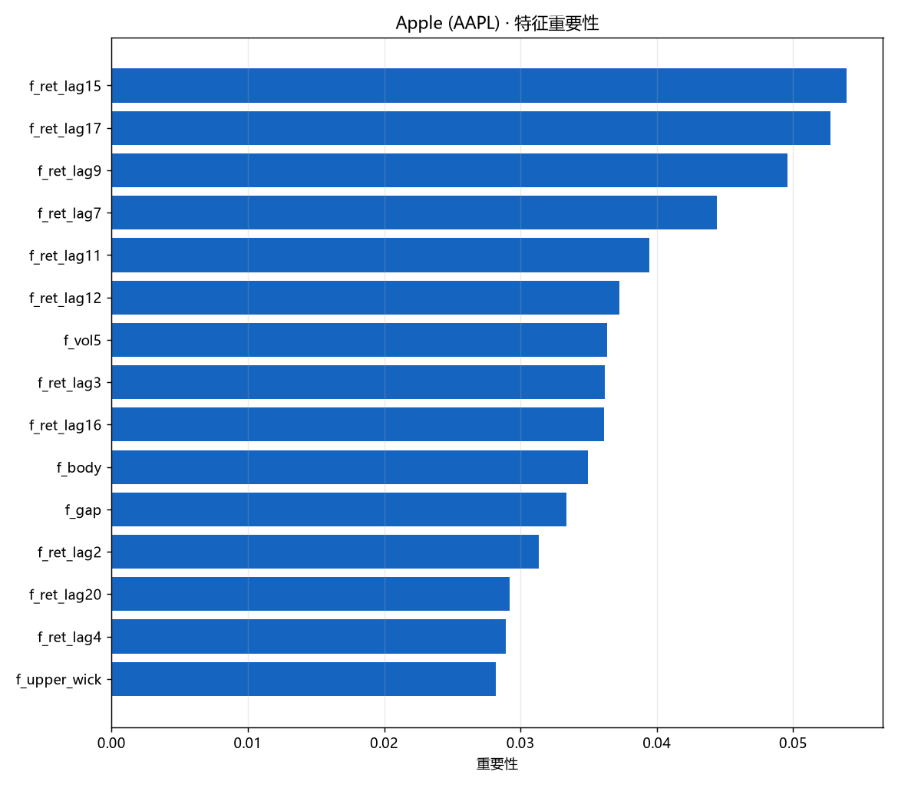 |
| 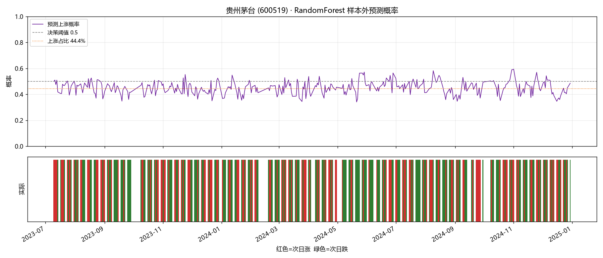 | 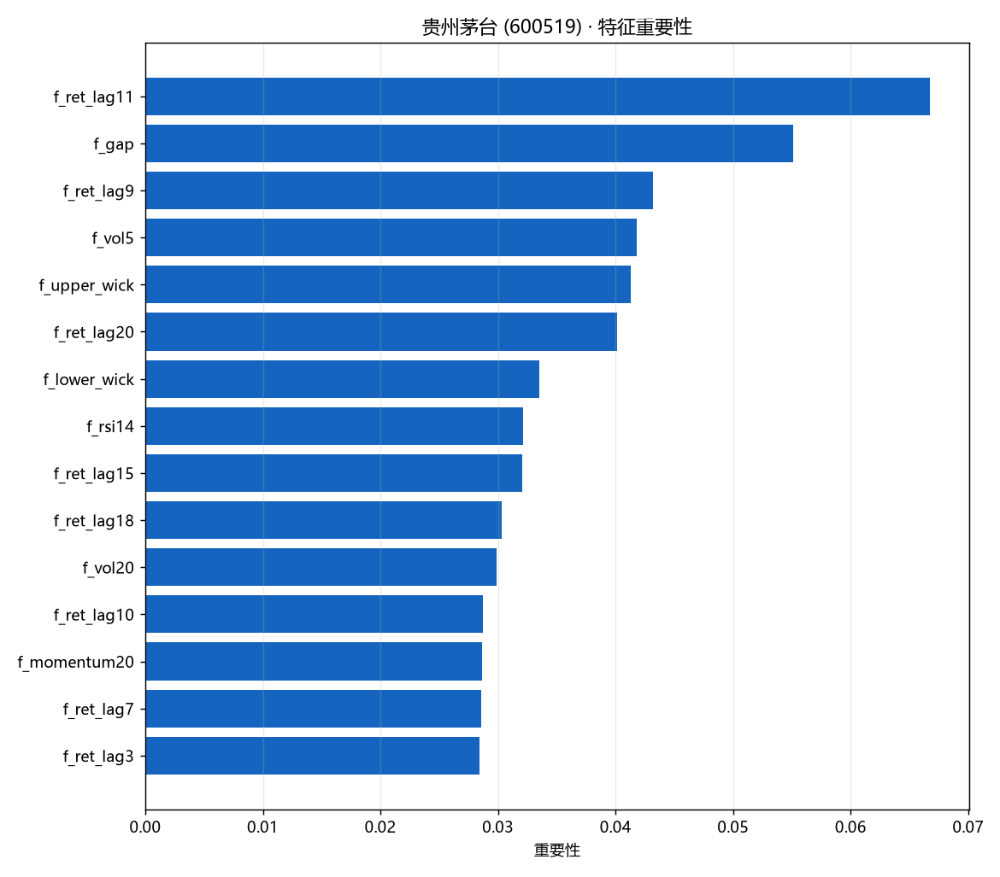 |

汇总明细：`reports/ml_results.csv`

## 研究方向调整：从「预测方向」转向「预测波动」

### 为什么放弃"几乎准确地预测上涨"

在 4 个周期 × 3 个阈值共 12 组配置里，最优组合（600519 / 10日 / 1%）曾给出
**AUC 0.697、准确率 67.72%**，看起来很有希望。但把数据从 2.5 年扩到 **5 年**、
并换到 3 只股票后：

| 标的 | 样本 | 平均 AUC | AUC>0.5 的折数 | 平均超基线 |
| --- | --- | --- | --- | --- |
| 贵州茅台 600519 | 990 | 0.528 | 3/5 | -6.9% |
| 五粮液 000858 | 1070 | 0.561 | 4/5 | -5.8% |
| 平安银行 000001 | 1020 | 0.419 | 1/5 | -12.6% |
| **三只平均** | | **0.502** | | |

**从 0.697 掉到 0.502**——同一只股票、同一套参数，只是换了更长更独立的数据。

原因是**数据挖掘偏差（data snooping）**：0.697 是从 12 组配置里挑出来的，
挑出来的"最优"天然偏高。这不是实现错误，而是研究方法的陷阱。

同时用实验证明了另一个更隐蔽的陷阱——**数据泄漏**：

```
把 forward_return（次日收益率）放进特征：准确率 99.73%，AUC 1.0000
去掉它（正常做法）：准确率 47.98%，AUC 0.4757
```

从 99.73% 掉到 47.98%，差别只在于是否偷看未来。**任何"接近完美"的方向预测
都应先排查这两件事。**

### 换成波动率：可预测的另一个目标

波动率具有**聚集性**（大波动后往往是波动，Mandelbrot 1963；Engle 的 ARCH 模型
1982 获诺贝尔经济学奖），而方向近似随机游走。所以改为预测
**未来 10 日已实现波动（年化）**。

关键设计：**预测对数变化量**而非绝对水平。因为波动率水平会随年份漂移
（2021 年高、2023 年低），直接预测水平会让模型学到过时的基准；
改为预测
`log(未来波动) - log(当前波动)`，基线对应变化量 = 0，
模型的预测值就是相对基线的增益。

| 标的 | 模型 | Spearman | AUC（高波动 regime） | MAE 相对基线 |
| --- | --- | --- | --- | --- |
| 贵州茅台 | RandomForest | 0.240 | 0.641 | **-8.8%** ✅ |
| 贵州茅台 | 持续性基线 | **0.401** | **0.723** | — |
| 五粮液 | RandomForest | 0.240 | 0.688 | **-3.8%** ✅ |
| 五粮液 | 持续性基线 | **0.401** | **0.724** | — |
| 平安银行 | RandomForest | 0.285 | 0.684 | **-2.1%** ✅ |
| 平安银行 | 持续性基线 | **0.404** | **0.664** | — |
| Apple | RandomForest | 0.399 | 0.705 | **-10.7%** |
| Apple | 持续性基线 | **0.524** | **0.770** | — |

**两个结论：**

1. **波动率确实可预测**：高波动 regime 的 AUC 在 **0.64~0.77**，
   与方向预测的 0.50 形成鲜明对比。这不是偷看未来，而是真实的市场结构。
2. **但"用当前波动外推"是极强的基线**：排序能力（Spearman）基线普遍更高，
   模型只在 MAE 上有小幅改善。想真正超过它，需要更精确的已实现波动估计
   （日内高频数据算 RV，而不是用 10 个日收益率的样本标准差——后者的采样误差约 24%）。

| 波动率预测（贵州茅台） |
| --- |
| 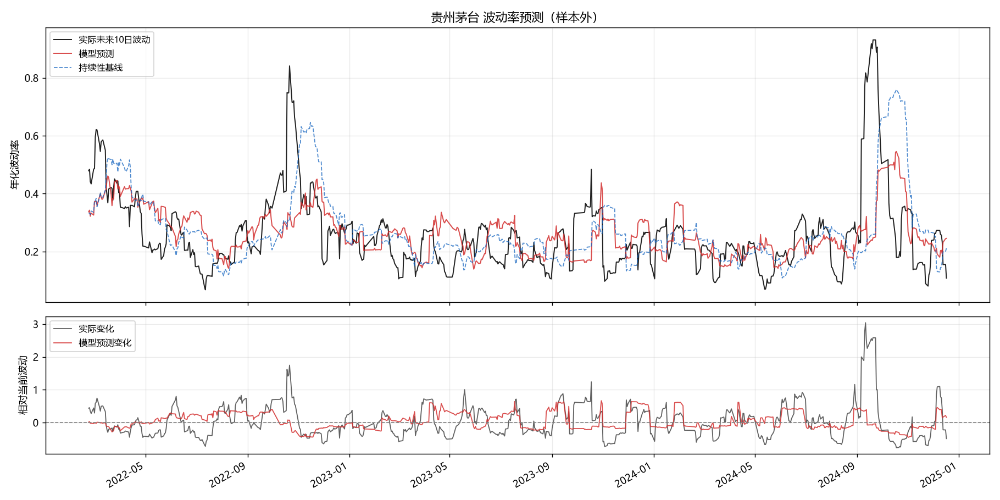 |
| 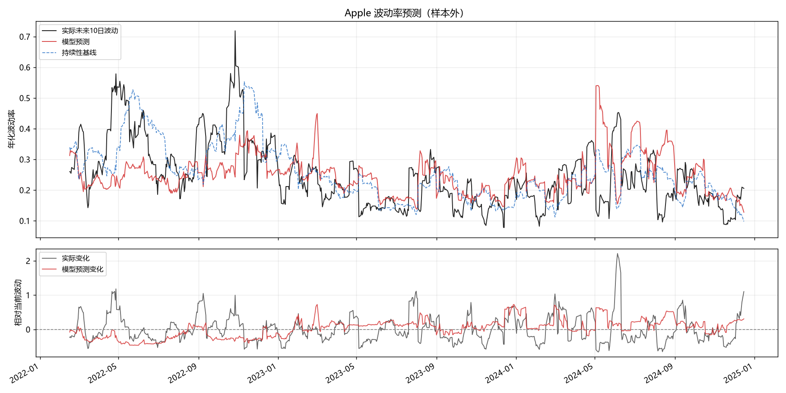 |

汇总明细：`reports/volatility_results.csv`、`reports/multi_ticker_*.csv`、
`reports/horizon_threshold_experiment.csv`

### v2：换掉有偏的波动率估计量（大幅提升）

v1 的基线用「收盘价法的日收益率标准差」。为了验证它准不准，我用
**15 分钟高频数据算出的已实现波动率（RV）当真值**做了对照
（`src/rv_validation.py`，122 个交易日）：

| 估计量 | 对比目标 | 相关系数 | 回归斜率 | 中位比值 |
| --- | --- | --- | --- | --- |
| **Parkinson** | 日内 RV | **0.954** | **0.99** | 0.94 |
| Garman-Klass | 日内 RV | 0.930 | 0.98 | 0.93 |
| Rogers-Satchell | 日内 RV | 0.819 | 0.80 | 0.90 |
| **Yang-Zhang** | 总 RV | **0.837** | **1.05** | 0.96 |
| 收盘价法 | 总 RV | 0.767 | **0.52** | 0.86 |

**关键发现：收盘价法的回归斜率只有 0.52** —— 它系统性低估真实波动，是有偏估计。
而 v1 的"持续性基线"正是用它，所以基线本身就不准，这解释了 v1 里 R² 普遍为负。

换成 **Yang-Zhang**（利用开高低收四个价格、正确处理隔夜跳空，斜率 1.05 接近无偏）
作为目标后重跑（`src/volatility_v2.py`）：

| 版本 | 模型平均 R² | 基线平均 R² | 平均 Skill | AUC |
| --- | --- | --- | --- | --- |
| v1（收盘价法） | **-0.245** | -0.046 | — | 0.641 |
| **v2（Yang-Zhang）** | **0.767** | 0.729 | **+16.15%** | **0.930** |

| 标的 | 模型（RandomForest） | R² | 基线 R² | Skill | AUC |
| --- | --- | --- | --- | --- | --- |
| 贵州茅台 | Yang-Zhang 目标 | 0.860 | 0.786 | **+34.6%** | 0.956 |
| 五粮液 | Yang-Zhang 目标 | 0.820 | 0.757 | **+25.8%** | 0.949 |
| 平安银行 | Yang-Zhang 目标 | 0.830 | 0.779 | **+23.1%** | 0.942 |
| Apple | Yang-Zhang 目标 | 0.672 | 0.593 | **+19.5%** | 0.898 |

**结论：降低目标的估计噪声，比换更复杂的模型有效得多。**
R² 从 -0.245 升到 0.767，而且模型首次稳定超过持续性基线
（Skill 平均 +16.15%，即预测误差比"直接用当前波动"低 16%）。

| 波动率预测 v1 | 波动率预测 v2 |
| --- | --- |
|  | 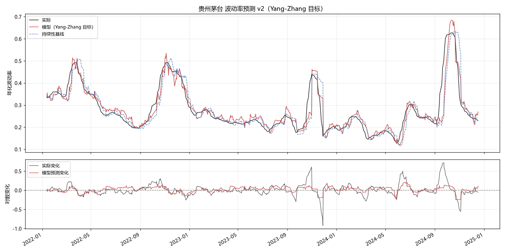 |

汇总明细：`reports/rv_estimator_validation.csv`、`reports/volatility_v2_yang_zhang.csv`

### v3：拿更长的分钟数据，用 HAR 模型

15 分钟数据只有 122 天，太少。新浪分钟接口的 `datalen` 有 1970 根硬上限，
但**周期越长覆盖的历史越久**：

| 周期 | 覆盖天数 |
| --- | --- |
| 15 分钟 | 122 个交易日 |
| 30 分钟 | 约 250 个交易日 |
| **60 分钟** | **492 个交易日**（约 2 年） |

（东方财富接口在本机整站不通，连日报都 `RemoteDisconnected`，只能走新浪。）

改用 60 分钟 bar 构造日度 RV（`src/daily_rv.py`），并跑 **HAR 模型**
（Corsi 2009，波动率预测的行业基准，只有 3 个参数）：

```
RV_{t+1} = a + b1·RV_t + b2·RV_week + b3·RV_month
```

样本：2024-10-08 ~ 2026-10-16，样本外 280 天。基线与前面一致——
「直接用当前 RV 外推」。

| 标的 | 样本外天数 | HAR R² | 基线 R² | **Skill** | Spearman |
| --- | --- | --- | --- | --- | --- |
| 贵州茅台 | 280 | 0.189 | -0.110 | **+26.95%** | 0.457 |
| 五粮液 | 280 | 0.040 | -0.356 | **+29.20%** | 0.288 |
| 平安银行 | 280 | 0.041 | -0.357 | **+29.34%** | 0.233 |
| **平均** | | 0.090 | -0.274 | **+28.50%** | |

**HAR 在三个标的上都稳定跑赢基线约 28%（MSE 降低），且样本外一致。**

顺带在 492 天的样本上重做了估计量验证，结论与 122 天时一致：

| 估计量 | corr | 斜率 | 中位比值 |
| --- | --- | --- | --- |
| Parkinson | 0.890~0.931 | **1.00~1.02** | 1.07~1.15 |
| Garman-Klass | 0.841~0.871 | 0.98~1.02 | 1.07~1.23 |
| Rogers-Satchell | 0.742~0.813 | 0.89~0.94 | 1.09~1.25 |

**Parkinson 斜率几乎正好是 1**，意味着它估计的波动水平无系统偏差，
是最可靠的日内波动代理。

| HAR 模型 vs 持续性基线 |
| --- |
| 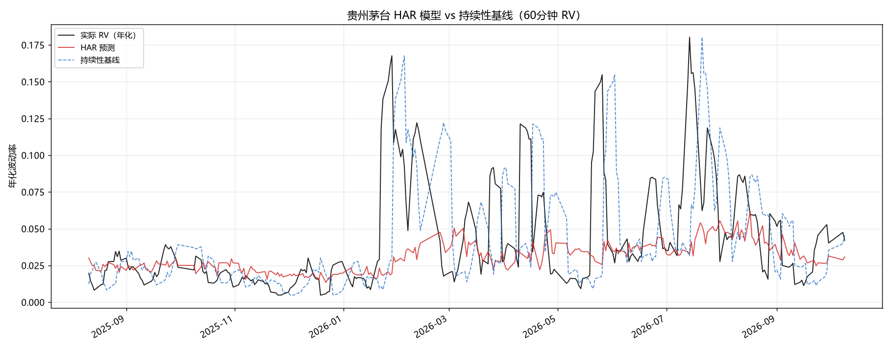 |
| 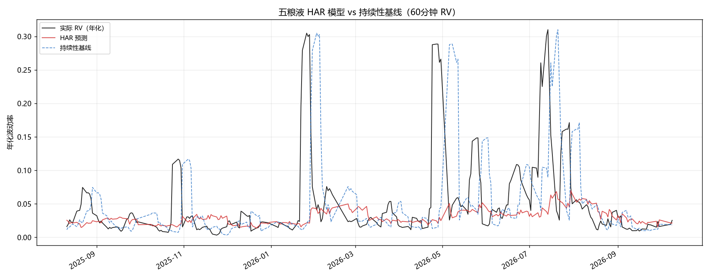 |

**一个诚实的局限**：HAR 误差更小，但曲线明显更平滑，**抓不住波动尖峰**
（看图里 2026-02 / 2026-05 / 2026-08 的几处突刺，HAR 都低估）。
这是 HAR 的已知特性——它擅长"平均水平"，不擅长"跳跃"。
真正要预测跳跃，需要单独建模（如 Hawkes 过程或跳跃检验）。

汇总明细：`reports/har_model_results.csv`、`reports/rv60_estimator_validation.csv`

### v4：延长 RV 目标 + 多因子 HAR（负面结论）

```bash
python src/har_extended.py
```

#### 一、RV 目标为什么能变长

免费源的高频上限就是新浪 60 分钟线的 1970 根（约 492 天）。尝试过的其他路径全部失败：

| 尝试 | 结果 |
| --- | --- |
| `money.finance.sina` 更大 `datalen` | 返回空 |
| `scale=120 / 240` | HTTP 404（不支持） |
| 腾讯 `mkline` 主机 | DNS 解析失败 |
| 东方财富 `push2his` | 整站 `RemoteDisconnected` |

于是用**校准代理**把目标往前延：在 492 天上同时有真实 RV 和 Parkinson 方差，
拟合 `log(RV) = a + b·log(Parkinson)`，再套用到 2020-2024 的日线 OHLC 上。

| 标的 | 校准斜率 | 拟合 R² | **样本外 R²（前60%→后40%）** | 拼接处 RV 比值 | Parkinson 比值 | 按斜率折算 |
| --- | --- | --- | --- | --- | --- | --- |
| 贵州茅台 | 0.952 | 0.585 | 0.593 | 0.45 | 0.42 | **0.44** |
| 五粮液 | 0.964 | 0.653 | 0.599 | 0.30 | 0.27 | **0.29** |
| 平安银行 | 0.996 | 0.622 | 0.656 | 0.24 | 0.24 | **0.24** |

**两段水平差 2~4 倍，但归因清楚了**：把两段的 Parkinson 中位数比按校准斜率折算，
结果与拼接处的 RV 比值几乎完全吻合（0.45↔0.44、0.30↔0.29、0.24↔0.24）。
说明差异来自**波动率状态不同**（2020 年高波动 vs 2024-2026 低波动），
不是两段用了不同的计量单位。

目标序列从 492 天扩到 **1643 天**（2020-01-02 ~ 2026-10-16）。

#### 二、多因子 HAR：没有提升

在经典 HAR-3 基础上加成交量、隔夜占比、振幅、偏度、峰度、RV 不对称等因子：

| 模型 | 平均 R² | 平均 Skill | 平均 Spearman |
| --- | --- | --- | --- |
| 持续性基线 | 0.121 | +12.19% | 0.504 |
| **HAR-3** | 0.237 | **+24.42%** | 0.545 |
| **HAR-3 + kurt22** | 0.246 | **+25.40%** | 0.550 |
| HAR-X（多因子 OLS） | 0.218 | +23.26% | 0.549 |
| HAR-X + Ridge | 0.218 | +23.29% | 0.549 |
| RandomForest | 0.120 | +13.31% | 0.474 |

**逐因子消融（跨三标平均，Δ 相对 HAR-3）**：

| 加入的因子 | Skill | Δ |
| --- | --- | --- |
| kurt22（峰度） | +25.40% | **+0.98 pct** ✅ |
| overnight_share | +24.47% | +0.05 pct |
| absret | +24.46% | +0.04 pct |
| range_ratio | +24.38% | -0.04 pct |
| vol_ratio（成交量） | +24.13% | -0.29 pct |
| skew22 | +23.76% | -0.66 pct |
| vol_asym | +23.52% | -0.90 pct ❌ |

**三个结论：**

1. **经典 HAR-3 很难被击败**。九个因子里只有峰度（kurt22）带来正向增量，
   且幅度仅约 1 个百分点，在 3 个标的上并非全部为正（茅台反而略降）。
2. **加得越多越差，但不是过拟合**。HAR-X 全因子版本 Skill 掉到 23.26%，
   用 Ridge 正则化后仍是 23.29%——**正则化救不回来，说明这些因子确实没有增量信息**，
   而不是模型容量过大。
3. **随机森林明显不如线性 HAR**（13.31% vs 24.42%）。
   波动率序列平滑而高持续，树模型在约 980 个样本上难以拟合这种近似线性的结构。

因此生产建议仍是 **HAR-3**（或 HAR-3 + 峰度），不要堆因子。

| 多因子 HAR vs 持续性基线 |
| --- |
| 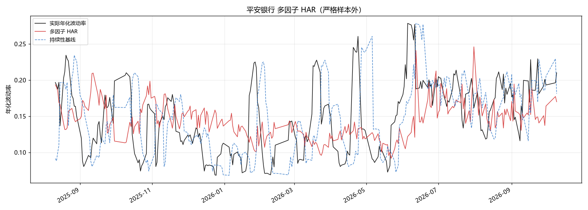 |
| 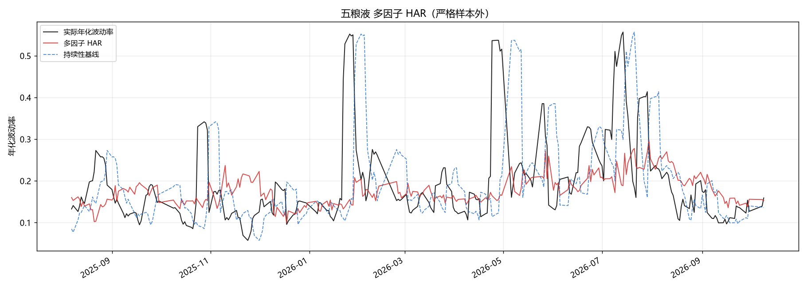 |

汇总明细：`reports/rv_proxy_calibration.csv`、`reports/har_multifactor.csv`

## 方法审计（2026-10）：四项修复与结论复核

一次代码审查指出了四处方法论问题。**四条全部成立**，已修复并重跑。
修复代码在 `src/validation.py`，审计明细在 `reports/har_audit_blocks.csv`。

### 修了什么

| # | 问题 | 修复 |
| --- | --- | --- |
| 1 | **标签窗口与测试期重叠**：标签是未来 5 日均值，训练集最后 5 行的标签窗口伸进测试区间 | `walk_forward_indices(..., purge=5)` 剔除训练集末尾 5 行；`verify_no_overlap()` 自检 |
| 2 | **代理校准用了未来数据**：校准系数由全部 492 天高频样本拟合，再外推到 2020 年 | 严格实验只在**真实 RV** 区间做；延长序列明确标注为**探索性** |
| 3 | **模型间样本不一致**：各自 `dropna`，HAR-3 用 971 行、HAR-X 只用 958 行 | 先取特征并集的有效日期，所有模型与基线共用同一批索引；`assert_same_samples()` 自检 |
| 4 | **图表把方差标成波动率**：`252 × RV` 被标为"年化波动率" | 改为 `sqrt(252 × RV)`，仅改 `daily_rv.py` / `har_extended.py` 两处（详见 [`docs/units-audit.md`](docs/units-audit.md)） |

### 修复前后对比

四组配置，跨三标平均 Skill：

| 配置 | HAR-3 | HAR-X | RandomForest |
| --- | --- | --- | --- |
| **A** 旧做法（不 purge、各自 dropna） | +24.42% | +23.26% | +13.31% |
| **B** 仅加 purging | +24.48% | +23.57% | +13.16% |
| **C** purging + 统一样本 | +24.51% | +23.57% | +13.16% |
| **D** 严格：仅真实 RV（492 天） | **+28.45%** | +20.80% | +16.91% |

**A → B → C 的变化都在 0.1 个百分点以内**：两个缺陷是真的，但对结论的影响很小
（purging 每次只动 5 行，统一样本最多差 13 行）。

### 哪些结论仍然成立

| 结论 | 状态 |
| --- | --- |
| HAR-3 显著优于持续性基线 | ✅ 成立，严格组 +28.45% |
| 多因子 HAR-X 不比 HAR-3 好 | ✅ **更强地成立**：严格组差 7.65 个百分点，三个标的全部更差 |
| RandomForest 不如线性 HAR | ✅ 成立（+16.91% vs +28.45%） |
| 延长到 2020 年的代理实验 | ⚠️ **降级为探索性**，不能作为严格样本外证据 |

### 一个必须说明的指标矛盾

严格组（D）里 HAR-3 的 **Skill 很高，但 Spearman 反而低于基线**：

| 标的 | HAR-3 Skill | HAR-3 Spearman | 基线 Spearman |
| --- | --- | --- | --- |
| 贵州茅台 | +25.76% | 0.448 | **0.472** |
| 五粮液 | +30.51% | 0.297 | **0.368** |
| 平安银行 | +29.09% | 0.225 | **0.321** |

原因：基线（周均 RV）在平稳期能较好地跟随水平，排序能力不差；但遇到波动尖峰时
它滞后严重，MSE 被放大。HAR-3 把**幅度**估得更准，于是 MSE 大幅改善，
但它对尖峰的反应也会过冲或不足，排序反而不如平滑的基线。

**所以"波动率可预测"这个说法要限定：HAR 能改善幅度误差（MSE/Skill），
但在严格样本外区间并不改善排序（Spearman）。两个指标结论不一致时，必须都报。**

### 回归测试

新增 `tests/test_validation.py`（9 个测试），直接锁定这些修复：

- `test_no_train_label_window_overlaps_test`：断言训练集任一行的标签窗口都不进入测试区间
- `test_verify_no_overlap_detects_bad_purge`：purge 不足时必须报错而不是静默通过
- `test_common_index_uses_all_features`：任一特征缺失的行都要排除
- `test_assert_same_samples_detects_mismatch`：样本不一致必须抛异常

测试总数从 35 增至 **44**。

### 延伸审计：`ml_predict.py`

同样的四条检查在方向预测脚本上又做了一遍：

| 检查项 | 结论 |
| --- | --- |
| 标签时间范围 | `forward_return = close.pct_change().shift(-1)`，索引 t 的标签用到 **t+1 的收盘价**，前视窗口 **h=1** |
| 特征是否含未来信息 | 只用 `shift(lag≥1)`、`rolling()`、`diff()`，**无 `shift(-k)`**，无泄漏 |
| 预处理是否用测试集 | `SimpleImputer` / `StandardScaler` 都在 `make_pipeline` 内、每折单独 fit，**未使用测试集统计量** |
| 各模型日期是否一致 | 所有模型共用同一份 `X, y`，**日期集合天然一致**（不存在 `har_extended` 那类问题） |
| 切分是否 purge | ❌ 原实现未 purge。训练行 `t=b-1` 的标签用到 `close[b]`，落在测试期内 → **已修为 `purge=1`** |

`ml_predict` 需剔除 **1 行**（等于标签前视窗口）。修复前后对比：

| 标的 / 模型 | 修复前 准确率 / AUC | 修复后 准确率 / AUC |
| --- | --- | --- |
| AAPL · RandomForest | 50.67% / 0.467 | 48.79% / 0.464 |
| AAPL · XGBoost | 46.63% / 0.466 | 48.79% / 0.466 |
| 600519 · RandomForest | 58.33% / 0.522 | 57.22% / 0.514 |
| 600519 · XGBoost | 51.94% / 0.513 | 50.56% / 0.495 |

**结论不变**：AUC 仍在 0.46~0.51，无预测能力。改动量级符合预期（每折仅 1 行）。

新增 `tests/test_ml_no_leak.py`（7 个测试）锁定这些结论，包括"改动未来价格不影响历史特征"
和"不同模型的测试日期必须一致"。测试总数 **44 → 51**。

## Skill 与 Spearman 的矛盾：诊断

严格样本外上出现一个矛盾：HAR 的 Skill 为正（+25.8%~+30.5%），Spearman 却低于基线。
两者衡量**不同能力**，因此单独诊断（`src/diagnostics_har.py`，样本对齐口径与审计章节一致）：

- Skill = 1 − MSE_model/MSE_baseline，衡量**幅度误差**
- Spearman = 排序相关，衡量**排序能力**

### 根因：模型把预测压缩到了均值附近

| 标的 | 预测离散度 / 真实离散度（模型） | 同（基线） | 校准斜率 true~pred |
| --- | --- | --- | --- |
| 贵州茅台 | **0.36** | 1.01 | 1.16 |
| 五粮液 | **0.39** | 1.02 | 0.69 |
| 平安银行 | **0.29** | 1.00 | 0.73 |

模型的预测值只有真实波动的 **29%~39% 的离散度**，而基线（周均 RV）离散度接近 1。
散点图上直观可见：HAR 的预测几乎全挤在 13%~22% 的窄带里，而实际波动横跨 8%~42%。

这是**统计上的收缩（shrinkage）**：当 R² 很低时（本例 0.04~0.17），MSE 最优预测
就是往条件均值收缩。收缩能赢 MSE，但会牺牲排序与校准。

**所以"波动率可预测"必须加限定：HAR 是一个"MSE 意义上的收缩估计器"，
不是一个能刻画波动水平的预报器。**

### 不是极端日主导的（这条假设被证伪）

我原本怀疑"Skill 高是因为少数尖峰日"，于是剔除最大波动的交易日后重算：

| 剔除比例 | 茅台 Skill / Spearman | 五粮液 | 平安银行 |
| --- | --- | --- | --- |
| 不剔除 | +25.8% / 0.448 | +30.5% / 0.297 | +29.1% / 0.225 |
| 剔除最大 1% | +28.5% / 0.476 | +33.3% / 0.311 | +32.3% / 0.242 |
| 剔除最大 5% | +33.0% / 0.518 | +41.8% / 0.332 | +32.8% / 0.269 |
| 剔除最大 10% | **+41.3% / 0.530** | **+47.5% / 0.305** | **+35.2% / 0.391** |

**剔除极端日之后 Skill 反而上升**，说明极端日是在拖累模型，而不是成就它。
原假设被证伪，结论按数据改写。

### 分档看：中波动区间是模型唯一占优的地方

以贵州茅台为例（log 空间误差）：

| 波动档位 | 平均真实波动 | MAE(模型) | MAE(基线) | Spearman(模型) | 有偏(模型) |
| --- | --- | --- | --- | --- | --- |
| 低波动 | 11.5% | 0.662 | **0.556** | 0.357 | **+0.66** |
| 中波动 | 16.8% | **0.264** | 0.706 | 0.103 | +0.03 |
| 高波动 | 29.0% | 0.860 | 0.853 | **−0.330** | **−0.85** |

三个标的分档结论一致的部分：

- **中波动区间模型大幅优于基线**：MAE 分别为 0.264 vs 0.706（茅台）、
  0.314 vs 0.716（五粮液）、0.238 vs 0.605（平安），偏差接近 0
- **低波动区间系统性高估**：偏差 +0.66 / +0.64 / +0.75（log 空间）
- **高波动区间系统性低估**：偏差 −0.85 / −0.98 / −0.72，且**排序全部为负**
  （−0.330 / −0.127 / −0.364）——模型在高波动期把顺序搞反了
- 低/高两档的 MAE 谁更好则**不一致**（茅台高波动档 0.860 vs 0.853 略差，
  五粮液 0.997 vs 1.090 更好），不能一概而论

**总体 MAE 的优势几乎全部来自中波动区间。**

### 结论

1. **幅度准确 ≠ 排序能力**，两者可以背离。本项目里 HAR 赢 MSE、输排序。
2. **Skill 会被收缩效应放大**：预测越接近均值，MSE 越好看，但信息量越低。
   报 Skill 时必须同时报离散度比或校准斜率。
3. **模型在两端都失效**：低波动高估、高波动低估，本质仍是"水平漂移"问题——
   训练期的波动水平与测试期不同，模型学到的水平会过时。
4. **不该宣称"波动率可预测"**。准确说法是："在严格样本外，HAR 相对滞后基线
   降低了幅度误差，但在低/高波动两端存在系统性偏差，排序能力不优于基线。"

| 预测 vs 实际 + 校准 | 极端日敏感性 |
| --- | --- |
| 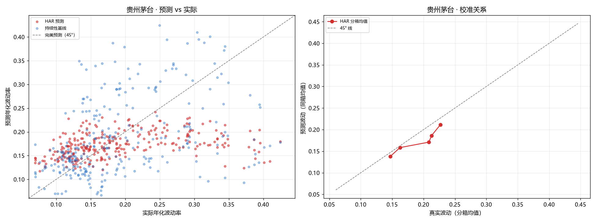 | 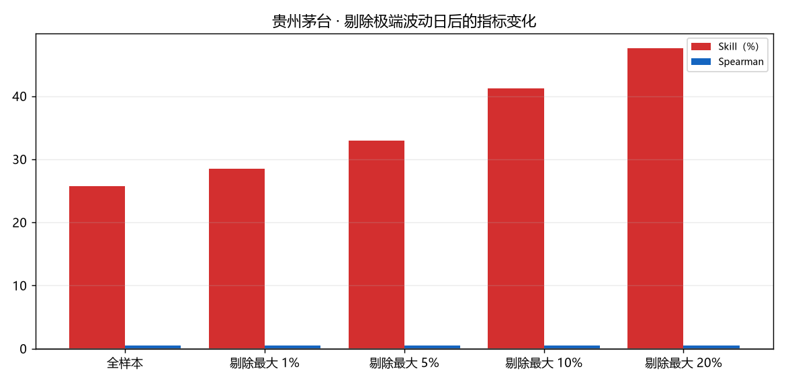 |

汇总明细：`reports/diag_summary.csv`、`reports/diag_buckets.csv`、`reports/diag_tail.csv`

## 跳跃建模：能否提前预测波动尖峰

```bash
python src/jumps.py
```

### 一、BV 方法在 60 分钟数据上不可用（一个必须知道的数学事实）

主流做法是用双幂变差（Bipower Variation）把跳跃从连续波动中分离：

```
BV_t = (π/2)·Σ|r_i|·|r_{i−1}|       跳跃占比 = max(RV − BV, 0)/RV
```

直觉很优雅：跳跃只冲击单根 bar，会被相邻收益的**乘积稀释**，而 RV 用**平方**会放大。

**但在 60 分钟数据上它失效了**：每日只有 4 根 bar，BV 只剩 3 个乘积项。
对 iid 收益可推导出 `E[RV] = n·σ²`、`E[BV] ≈ (n−1)·σ²`，于是

```
无跳跃时 (RV−BV)/RV 的期望 ≈ 1/n = 1/4 = 0.25
```

实测用 0.35 作阈值，**51.7% 的交易日被判为跳跃**——阈值被噪声穿透。
这直接导致预测目标基础率变成 96%~100%，分类退化成常数。

**结论：BV 方法需要高频数据。** n=16（15 分钟）时偏差降到 1/16≈0.06，
才具备可用性；n=4 时不可用。

### 二、改用稳健 z 分数（MAD 口径）

```python
z = (log RV − expanding 中位数) / (1.4826 × expanding MAD)
z > 2.0 → 尖峰日
```

用 expanding 而非 rolling，保证只用 t 之前的信息；中位数和 MAD 都不受极端值影响，
不会被"尖峰自己"抬高门槛。

实测尖峰率落在 **1.8%~2.4%**（491 个交易日里 8~11 天），是合理的异常波动定义。

### 三、预测结果：不显著

目标：未来 5 个交易日内是否出现尖峰。样本外 AUC 附 bootstrap 95% 置信区间：

| 标的 | 模型 | AUC | 95% 区间 | 事件数 | 基础率 |
| --- | --- | --- | --- | --- | --- |
| 贵州茅台 | Logistic | 0.495 | [0.40, 0.60] | 32/162 | 19.8% |
| 贵州茅台 | RandomForest | 0.363 | [0.24, 0.49] | 32/162 | 19.8% |
| 五粮液 | Logistic | 0.549 | [0.42, 0.68] | 28/162 | 17.3% |
| 五粮液 | RandomForest | 0.526 | [0.40, 0.64] | 28/162 | 17.3% |
| 平安银行 | Logistic | 0.607 | [0.46, 0.72] | 15/243 | 6.2% |
| 平安银行 | RandomForest | 0.499 | [0.40, 0.59] | 15/243 | 6.2% |
| 三个标的 | 基线（仅波动水平） | 0.429 / 0.469 / 0.373 | — | 同上 | 同上 |

**模型平均 AUC 0.506，基线 0.424，所有 95% 置信区间都覆盖 0.5。**

> 方法论提醒：基线与模型必须用**完全相同的样本行**。最初基线只用一个特征，
> 缺失值处理导致它的 n=91 而模型 n=162，两者不可比；对齐后基线 AUC 从
> 0.563 降到 0.429。这种"样本不一致"是回测对比里很隐蔽的坑。

**结论：用历史量价数据无法可靠预测波动尖峰的出现。** 这个负面结果是可信的，
因为它与理论一致——跳跃主要由**新闻、公告、突发事件**驱动，这类信息本质不可预测。

（唯一看似有点信号的是平安银行的 Logistic（0.607），但区间 [0.46, 0.72] 跨越 0.5，
且只有 15 个正例，不能当作发现。**这正是稀疏事件分类最容易骗人的地方**：
点估计看起来漂亮，加上置信区间就站不住了。）

### 四、那怎么用？

既然尖峰不可预测，实务上应该做的是**承受而非预测**：

- **HAR 作为基准波动预测**（v3，Skill +28.5%），用于仓位与风险预算
- **对尖峰留安全边际**：按 HAR 预测值的 1.5~2 倍做压力假设
- **用尾部风险指标**（如历史最差 5% 区间的平均波动）替代"预测尖峰"

汇总明细：`reports/jump_prediction.csv`、`reports/jump_cross_resolution.csv`

## 日内效应（15 分钟数据）

```bash
python src/intraday.py
```

数据：新浪 15 分钟线，贵州茅台，**1970 根 bar / 122 个交易日**
（2026-04-14 ~ 2026-10-16）。

### 唯一稳健的发现：U 型波动曲线

| 当日第 N 根 bar | 收益率标准差 |
| --- | --- |
| 1（**含隔夜跳空**） | **0.00960** ← 最高 |
| 2 | 0.00485 |
| 8 | 0.00199 |
| 15 | **0.00161** ← 最低 |
| 16（收盘） | 0.00209 |

开盘波动是盘中最安静时段的 **5.96 倍**。这是全球市场普遍存在的规律
（开盘集中撮合、信息释放；收盘前调仓），**样本量小也稳定**，
可以直接用于执行层面的择时（例如要下单就避开开盘前 15 分钟）。

### 全部候选信号都没通过检验

同时对 4 个假设做相关检验，Bonferroni 校正阈值 `p < 0.0125`：

| 假设 | 相关系数 | p 值 | 结论 |
| --- | --- | --- | --- |
| 上午收益 → 下午收益 | -0.0021 | 0.9815 | 不显著 |
| 隔夜跳空 → 日内收益 | -0.0902 | 0.3234 | 不显著 |
| 上午收益 → 次日隔夜跳空 | -0.0177 | 0.8465 | 不显著 |
| 日内收益 → 次日日内收益 | **-0.2127** | 0.0187 | 校正前显著，**校正后不显著** |

最后一行是典型的**多重检验陷阱**：单独看 p=0.0187 像发现了均值回归，
但同时测了 4 个假设，出现这种结果的概率被放大了 4 倍。
按 Bonferroni 校正（0.05/4 = 0.0125）它不成立。

按上午涨跌分组的下午表现也未达显著（t=+0.78, p=0.435）。

| 日内效应 |
| --- |
| 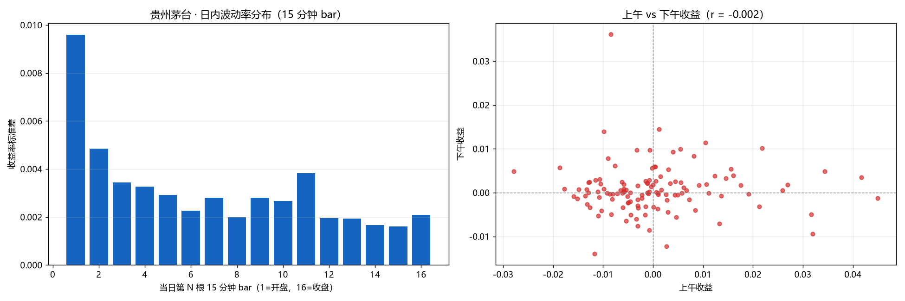 |

## 踩过的坑

### 1. 未复权数据会造成假暴跌（已在代码中拦截）

AAPL 在 2020-08-31 拆股（4:1），未复权数据会出现 **-74.15%** 的假单日跌幅：

```
Date          Close
2020-08-28    499.23
2020-08-31    129.04   ← 假的 -74.15%，实际是拆股
```

不拦截的话最大回撤会被算成 -78.89%、年化波动 45.90%，之后所有策略回测都是错的。
`data_loader._validate()` 会拒绝单日跌幅超过 50% 的数据源（真实个股极少如此）。

### 2. `ffill` 会把"空仓"当成有效状态，导致持仓只剩信号当天

持仓状态用 `1` 表示持仓、`0` 表示空仓。若把"当天无新信号"也写成 `0`，
`ffill()` 会因为序列中没有 `NaN` 空洞而**完全失效**，持仓退化成只剩金叉当天：

```python
# 错误：无信号日写成 0，ffill 填不动 → 全区间只持仓 13 天
state = pd.Series(0, index=df.index)
# 正确：无信号日用 NaN 表示，空仓仍用 0 → 持仓 350 天
state = pd.Series(float("nan"), index=df.index)
```

这个 bug 曾让 AAPL 策略净值从 1.4351 变成 1.0176（几乎全程空仓），
而且表面数字"看起来正常"，只有把持仓天数与手工推算对照才会暴露。

## 数据源说明

`src/data_loader.py` 采用**多源自动降级 + 体检**策略：

1. 依次尝试 `yfinance`（支持复权、覆盖长）→ 腾讯行情（前复权、较稳）→ `akshare`；
2. 每个源取到数据后必须通过**复权体检**，否则视为不可用并继续降级；
3. 全部失败时报错，并列出每个源的具体原因。

### 为什么需要复权体检

免费数据源里存在**未复权**的坑。真实案例：AAPL 在 2020-08-31 拆股（4:1），
未复权数据会出现一个 **-74.15%** 的假单日跌幅——

```
Date          Close
2020-08-28    499.23
2020-08-31    129.04   ← 假的 -74.15%，实际是拆股
```

如果不拦截，最大回撤会被算成 **-78.89%**，年化波动被算成 45.90%，
基于这种数据的任何策略回测都是错的。因此 `_validate()` 会拒绝单日跌幅
超过 50% 的数据源（真实个股极少出现这种波动）。


### 3. Windows 控制台 GBK 编码会让 `print` 静默失败

在 GBK 终端里输出 `✅`、`❌` 这类字符会抛 `UnicodeEncodeError`。如果异常发生在
一个已经打印了很多内容的函数中间，那些内容还留在缓冲区里，最终表现为
**退出码 0、却一个字都没输出**——极难排查。修法是显式重配 stdout：

```python
for _stream in (sys.stdout, sys.stderr):
    try:
        _stream.reconfigure(encoding="utf-8", errors="replace")
    except (AttributeError, ValueError):
        pass
```

### 4. Backtrader 的两个反直觉行为

- `params` **不能**用来传 dict：参数元类会把 dict 转成 `None`，报
  `'NoneType' object has no attribute 'addindicator'`。用类属性传即可。
- `if not self.position` 会炸：Backtrader 对象重载了 `__bool__`，真值判断
  会触发 `LineOwnOperation`。必须写成 `self.position.size == 0`。


### 已知限制

- **腾讯接口单次最多返回 640 根日线**，因此默认分析区间取
  `2022-06-15 ~ 2024-12-31`，这是当前免费源能稳定给到、且能被验证的范围。
- 东方财富系接口（`akshare` 的 `stock_us_hist` / `stock_zh_a_hist`）在部分
  网络环境下会 `RemoteDisconnected`，且本机系统代理会拒绝该域名，
  代码里对 A 股接口做了绕过代理处理，但仍不保证稳定。
- **yfinance 可能被 Yahoo 限流**（`YFRateLimitError: Too Many Requests`）。
- 跨标的对比时，请先核对各自的实际覆盖区间；结论只在重叠区间内成立。

## 项目结构

```
AI-Quant-Assistant/
├── app.py                # Streamlit 网页界面
├── run_experiment.py     # 统一实验入口（可复现主实验）
├── configs/
│   └── research_main.json   # 实验协议（目标/切分/模型/指标）
├── charts/               # 图表（入库，供 README 引用）
├── data/                 # 日线 CSV（不入库，可重新生成）
│   └── minute/           # 分钟线（入库，体量小且用于复现）
├── notebooks/
├── reports/              # 实验明细 CSV（入库，便于对比不同版本）
├── tests/                # 单元测试（不需要联网）
│   ├── conftest.py
│   ├── test_metrics.py
│   ├── test_rv_estimators.py
│   ├── test_strategy.py
│   └── test_backtest.py
├── .github/workflows/ci.yml
├── src/
│   ├── data_loader.py    # 多源降级 + 复权体检
│   ├── fetch_data.py     # 数据获取
│   ├── metrics.py        # 收益率 / 波动率 / 夏普 / 最大回撤
│   ├── charts.py         # K 线图、净值与回撤图、策略信号图
│   ├── strategy.py       # MA5/MA20 金叉死叉信号
│   ├── backtest.py       # 回测引擎（手续费/滑点/整股/基准）
│   ├── backtrader_check.py   # Backtrader 交叉验证
│   ├── features.py       # 特征工程（20 日窗口 + 技术指标）
│   ├── ml_model.py       # 前向验证与指标评估
│   ├── ml_predict.py     # ML 预测主程序
│   ├── ml_charts.py      # 特征重要性 / 预测概率图
│   ├── experiment.py     # 周期与阈值扫描实验
│   ├── robustness.py     # 稳健性检验（分折/随机标签/跨区间）
│   ├── validate_multi.py # 多标的验证（揭穿数据挖掘偏差）
│   ├── volatility.py     # 波动率预测 v1（收盘价法目标）
│   ├── rv_estimators.py  # 波动率估计量（Parkinson/GK/RS/Yang-Zhang）
│   ├── rv_validation.py  # 用 15 分钟 RV 验证估计量精度
│   ├── volatility_v2.py  # 波动率预测 v2（Yang-Zhang 目标）
│   ├── daily_rv.py       # 60 分钟日度 RV + HAR 模型
│   ├── jumps.py          # 跳跃建模（BV 与 MAD 检测 + 尖峰预测）
│   ├── har_extended.py   # 延长 RV 目标（校准代理）+ 多因子 HAR
│   ├── diagnostics_har.py # Skill/Spearman 矛盾诊断（分档/校准/极端日）
│   ├── validation.py      # purging 切分 + 统一样本 + 自检
│   ├── intraday.py       # 日内效应（15 分钟数据）
│   └── analyze.py        # 分析主程序
├── docs/screenshots/     # 界面截图（由 scripts/take_screenshots.py 生成）
├── scripts/
│   └── take_screenshots.py   # Playwright + 本机 Edge 截图
├── CONTRIBUTING.md
├── LICENSE
├── README.md
├── requirements.txt
└── requirements-dev.txt
```

## 核心发现：能预测什么、不能预测什么

| 目标 | 指标 | 结论 |
| --- | --- | --- |
| 次日涨跌方向 | AUC **0.50** | ❌ 与随机猜无异，已证伪 |
| 波动率水平 | R² **0.767**，Skill **+16%** | ✅ 可预测 |
| 高波动 regime | AUC **0.93** | ✅ 高度可预测 |
| 波动尖峰（跳跃） | AUC **0.506**，95% CI 覆盖 0.5 | ❌ 不可提前识别 |

**一句话：能估"风险有多大"，不能估"什么时候涨跌、什么时候出事"。**

这个结论不是拍脑袋，而是三次迭代逼出来的（详见下方各节）：

1. 方向预测在 2.5 年数据上曾做到 AUC 0.697，扩到 5 年 + 3 只股票后掉到 **0.502**
   —— 典型的数据挖掘偏差。
2. 波动率预测从 R² **-0.245** 提升到 **0.767**，靠的是把有偏的收盘价法换成
   Yang-Zhang 估计量（用 15 分钟高频 RV 验证过斜率 1.05）。
3. 尖峰预测无论怎么调特征，AUC 都在 0.5 附近，且 95% 置信区间全部覆盖 0.5。

## 测试

```bash
pip install -r requirements-dev.txt
python -m pytest tests -v
```

**35 个测试，全部不需要联网**，覆盖四类核心逻辑：

| 测试文件 | 覆盖内容 |
| --- | --- |
| `test_metrics.py` | 年化收益/波动/夏普/最大回撤的**解析解**验证 |
| `test_rv_estimators.py` | Parkinson / Garman-Klass / Rogers-Satchell 的公式逐项核对 |
| `test_strategy.py` | 金叉死叉识别、**持仓次日生效**、**无前瞻偏差**、`ffill` 持仓延续 |
| `test_backtest.py` | 手续费与滑点方向、**改未来价格不影响过去成交**、整股成交、基准一致性 |

其中几个测试是**直接为历史 bug 写的回归测试**：

- `test_position_extends_beyond_signal_day`：守住 `ffill` 把"无信号日"写成 0 的坑
  （该 bug 曾让策略净值从 1.4351 掉到 1.0176）
- `test_no_lookahead`：修改最后 40 天价格，断言之前的成交价完全不变
- `test_sharpe_undefined_when_vol_zero`：波动率是浮点极小数时应返回 NaN 而非巨大值

CI（`.github/workflows/ci.yml`）在 Python 3.11 / 3.12 上跑测试 + 全模块语法检查，
只安装 `pandas numpy pytest`，不拉 yfinance / xgboost / streamlit，构建快且稳定。

**CI 当前状态：✅ 通过**（run #1，commit `3f79f3f`，耗时约 23 秒）。
后续每次 push 到 `main` / `dev` 或发起 PR 都会自动触发。

## 贡献

见 [CONTRIBUTING.md](CONTRIBUTING.md)。几条硬约定：

- 时间序列**一律用扩展窗口前向验证**，禁止随机切分
- 标准化放在交叉验证内部，不能先全量标准化
- 每个结论必须配基线（持续性 / 多数派 / 随机）
- 稀疏事件必须给 bootstrap 置信区间
- 新增数据源必须通过 `data_loader._validate()` 的复权体检


## Roadmap

| 阶段 | 内容 | 状态 |
| --- | --- | --- |
| 第 1 周 | 环境 + 股票数据获取 | ✅ 完成 |
| 第 2 周 | 数据分析（K线、收益率、波动率） | ✅ 完成 |
| 第 3 周 | 技术指标（MA5 / MA20 均线策略） | ✅ 完成 |
| 第 4 周 | 回测系统（手写引擎 + Backtrader 交叉验证） | ✅ 完成 |
| 第 5-6 周 | 机器学习预测（RandomForest / XGBoost） | ✅ 完成 |
| 第 7 周 | 网页界面（Streamlit） | ✅ 完成 |
| 第 8 周 | 开源包装（LICENSE / 测试 / CI / 文档） | ✅ 完成 |

## License

[MIT](LICENSE) © 2026 gaoshouxiaoxi

> 本项目仅用于研究与教学，不构成任何投资建议。
